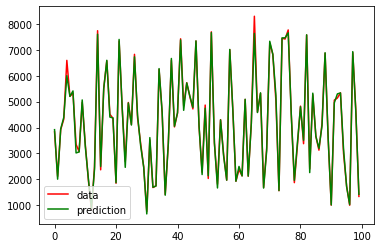
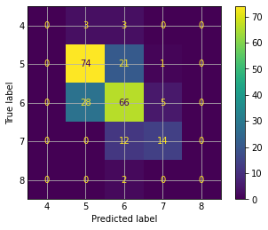

# Random Forest & AdaBoost

**Hyper-parameter tuning with GridSearchCV on regression and classification problems**

   

## Overview

Supervised learning with **Random Forest** on two datasets: preprocessing, training and prediction,
evaluation, hyper-parameter optimisation with `GridSearchCV` and an attempt to improve the best model with **AdaBoost**.

| Notebook | Problem | Dataset |
| --- | --- | --- |
| [`randomForest_bike.ipynb`](https://colab.research.google.com/github/Steven-Macas/random-forest/blob/main/randomForest_bike.ipynb) | Regression – bikes rented per day | Bike Sharing (`day.csv`) |
| [`randomForest_vino.ipynb`](https://colab.research.google.com/github/Steven-Macas/random-forest/blob/main/randomForest_vino.ipynb) | Classification – wine quality | Wine Quality (`WineQT.csv`) |

## Results

| Dataset | Model | Metric | Value |
| --- | --- | --- | --- |
| Bike Sharing | Random Forest + GridSearchCV | MAE | 75.0 |
| Bike Sharing | AdaBoost (Random Forest base) | MAE | **68.4** |
| Wine Quality | Random Forest + GridSearchCV | Accuracy | **67.2 %** |
| Wine Quality | AdaBoost (Random Forest base) | Accuracy | 65.5 % |

AdaBoost improves the regression error on the bike data, but not the wine classification.

<table>
  <tr><td align="center" valign="top"> Bike Sharing – real vs predicted</td><td align="center" valign="top"> Wine Quality – confusion matrix</td></tr>
</table>

*The notebooks are written in Spanish.*

---

Made by <b>Steven Macas</b> — Data Engineer &amp; Data Analyst · <a href="https://gointy.com">gointy.com</a> · <a href="https://www.linkedin.com/in/steven-macas">LinkedIn</a> · <a href="https://github.com/Steven-Macas">GitHub</a>
